# Redução de complexidade assintótica no Price-Watch

Projeto complementar de Análise de Algoritmos. Este relatório descreve as oito funções escolhidas (F1–F8), a análise formal antes e depois de cada uma, as estratégias adotadas, a evidência de que a saída não mudou e as medições de tempo × n.

Responsáveis:

| Aluno | Funções |
|---|---|
| João Felipe da Rocha Soares | F1, F7 |
| Vithor dos Santos | F2, F5, F8 |
| Paulo Ricardo | F3, F4, F6 |

Todos os números citados vêm dos CSVs em `docs/complexidade/dados/`. Os gráficos estão em `docs/complexidade/graficos/`.

---

## 1. Critério de escolha e inventário

### 1.1 Diagnóstico

O código do Price-Watch quase não tem algoritmo quadrático em memória. As listas são percorridas uma vez, e onde há busca já se usa `Map` ou `Set`. O custo que cresce com o tamanho dos dados está em três lugares:

1. **Idas ao banco dentro de laço (N+1).** A busca grava cada produto da SerpApi com 2 a 3 consultas por produto.
2. **Consultas que trazem a tabela inteira para usar uma fração.** Exemplos: todos os produtos excluídos para filtrar 24 URLs, todas as lojas ativas para validar uma, todos os favoritos para saber se um produto é favorito.
3. **Transferência desnecessária entre back e front.** O front baixa a lista completa de favoritos (cerca de 600 bytes por favorito) para consultar 1 ou 8 produtos.

Uma ida ao banco custa a latência de rede mais o processamento da consulta, algo entre 0,3 e 1 ms neste ambiente (Docker no Windows). Esse custo é várias ordens de grandeza maior que o de uma operação em memória (nanossegundos). Por isso as funções de maior custo do sistema são as que fazem Θ(n) idas ao banco, ou que leem e transferem Θ(N) linhas, e não as que fazem laços em memória.

### 1.2 Inventário das funções inspecionadas

Notação: N é o total de linhas da tabela; n, k e L são os tamanhos definidos em cada linha. "Ida" é uma consulta ao banco.

| Função | Arquivo | Custo antes | Observação |
|---|---|---|---|
| `searchProducts` (laço de `upsertProduct`) | `backend/src/services/productService.ts` | Θ(n) idas | **F1**: N+1 |
| `searchProducts` (produtos excluídos) | idem | Θ(D) linhas lidas e transferidas | **F2**: tabela inteira de excluídos |
| `searchProducts` (produtos locais) | idem | Θ(L) linhas transferidas e mapeadas | **F6** |
| `createProduct` | idem | Θ(S) linhas de lojas | **F3**: todas as lojas ativas |
| `updateProduct` | idem | O(S_u) (ILIKE sobre as lojas do usuário) | fora do escopo; ver achado A4 |
| `getShowcaseProducts` | idem | `take` + `count`, O(k) linhas | já paginada |
| `getProductById`, `listProductPriceHistory` | idem | O(log N) por índice; histórico com `take: 30` | já pontual |
| `listProductComparableOffers` | idem | O(r) sobre a resposta da SerpApi | já linear e limitado |
| `deleteProduct` | idem | 3 `count` indexados | já pontual |
| `parsePrice`, `parseDiscountPercent`, `mapSerpApiItem` | idem | Θ(tamanho do texto) | constante por item |
| `upsertProduct` (uso unitário) | idem | 2 a 3 idas | chamada única em favoritos e alertas |
| `createFavorite`, `deleteFavorite` | `backend/src/services/favoriteService.ts` | O(1) idas | pontual |
| `listFavorites` | idem | Θ(F) | necessário na tela de favoritos |
| `listPriceAlerts`, `listStores`, `listCategories`, `listPriceHistoryRecords` | services | Θ(N) | telas que mostram a lista inteira; reduzir exigiria paginação na UI |
| `registerUser` | `backend/src/services/authService.ts` | 1 `count` + 1 insert | constante |
| `loadProduct` (favorito) | `frontend/src/pages/ProductDetailPage.tsx` | Θ(F) bytes e tempo | **F4** |
| `loadSearchResults` / `loadShowcase` | `frontend/src/pages/HomePage.tsx` | Θ(F + k) | **F5** |
| `buildPageButtons` | idem | O(1), no máximo 8 botões | constante |
| `buildHistorySeries` | `frontend/src/pages/ProductDetailPage.tsx` | Θ(h log h) no pior caso | **F8** |
| `mapApiProduct`, menor e maior preço | idem | Θ(h) | linear, h ≤ 30 |
| métricas do Dashboard | `frontend/src/pages/DashboardPage.tsx` | Θ(h + a + f), 13 passadas | **F7** |
| filtros de AlertsPage, StoresPage, CategoriesPage, PriceHistoryPage, AdminProductsPage | `frontend/src/pages/*` | Θ(n) por filtro | linear sobre a lista exibida |

As oito escolhidas são as únicas cujo custo cresce com uma quantidade que **não** aparece na resposta: produtos da página × idas ao banco, todos os excluídos, todas as lojas, todos os favoritos e todos os locais. As demais funções são pontuais (O(1) idas), lineares no que exibem, ou limitadas por constantes do sistema. F7 e F8 entram como contraponto de "custo em memória" e servem para discutir o que **não** conta como mudança de classe.

---

## 2. Análise por função

Convenções:

- **c_rt** é o custo de uma ida ao banco: latência mais parsing e planejamento. É constante, mas grande.
- **c_row** é o custo de ler, serializar e transferir uma linha.
- **c** com índice são outros custos constantes.
- **N** é o total de linhas da tabela envolvida.
- Uma consulta por índice B-tree custa O(log N) para localizar o primeiro registro, mais O(r) para os r registros retornados.

**Como ler as medições.** Cada tabela traz três coisas:
- a inclinação no log-log entre os dois maiores n;
- um ajuste linear t(n) = a + b·n por mínimos quadrados sobre todos os pontos;
- o R² desse ajuste.

Uma função linear com custo fixo relevante (idas ao banco, chamada à SerpApi) tem a forma t = a + b·n. A inclinação entre dois pontos fica **abaixo de 1** enquanto a ainda pesa frente a b·n, e só tende a 1 quando b·n domina. Por isso, nas funções de banco, a classe é lida pelo ajuste: R² perto de 1 com b > 0 indica crescimento linear; b ≈ 0 indica custo constante em n. A inclinação serve de apoio.

**Cópias da versão original.** As versões originais usadas como referência ficam em `backend/bench/legacy/` e `frontend/bench/legacy/`. São cópias fiéis, com duas diferenças sem efeito na saída:
- formatação aplicada pelo Prettier;
- em `mapSerpApiItem`, o `if (válido) { comentário } else { ... }` virou `if (!válido) { ... }`, porque o código não pode ter comentários.

### F1 — upsert dos produtos da busca (`searchProducts` → `upsertProduct` em laço)

**Responsável:** João Felipe da Rocha Soares
**Arquivos:** `backend/src/services/productService.ts`, `backend/src/services/productBatchUpsert.ts`

**Antes**

```ts
await Promise.allSettled(searchResult.products.map((product) => upsertProduct(product)));

export async function upsertProduct(product: ProductDTO): Promise<string> {
  const existing = await prisma.product.findUnique({ where: { externalId: product.externalId } });
  if (existing && (existing.isManual || existing.isDeleted)) {
    return existing.id;
  }
  const previousPrice = existing ? Number(existing.price) : null;
  const savedProduct = await prisma.product.upsert({ where: { externalId: product.externalId }, update: { ... }, create: { ... } });
  if (existing && previousPrice !== null) {
    await recordProductPriceHistory(savedProduct.id, previousPrice, product.price);
  }
  return savedProduct.id;
}
```

**Depois**

```ts
await upsertProductsBatch(searchResult.products);

export async function upsertProductsBatch(products: ProductDTO[]): Promise<void> {
  if (products.length === 0) {
    return;
  }
  try {
    const externalIds = Array.from(new Set(products.map((product) => product.externalId)));
    const plan = planUpsertBatch(products, await findExistingProducts(externalIds), new Date());
    const statements = [
      ...(plan.inserts.length > 0 ? [insertProductsStatement(plan.inserts)] : []),
      ...(plan.updates.length > 0 ? [updateProductsStatement(plan.updates)] : []),
      ...(plan.history.length > 0 ? [insertHistoryStatement(plan.history)] : [])
    ];
    if (statements.length > 0) {
      await prisma.$transaction(statements);
    }
  } catch {
    return;
  }
}
```

`findExistingProducts` faz `SELECT ... WHERE "externalId" = ANY($1::text[])`. Cada comando de escrita recebe **um único parâmetro** JSON e expande as linhas com `jsonb_to_recordset`. `planUpsertBatch` é uma função pura: a partir da leitura única, simula em memória a execução sequencial dos upserts.

**Definição de n.** n é o número de produtos retornados pela SerpApi na página. Em produção n ≤ `limit` ≤ 24 (o controller limita `limit` a 24). Nos benchmarks n vai de 10 a 100.000, chamando o service diretamente.

**Contagem de operações — antes.** Para o produto i, sejam e_i ∈ {0,1} (já existe), b_i ∈ {0,1} (é manual ou excluído) e p_i ∈ {0,1} (o preço mudou).

| Linha | Custo | Execuções |
|---|---|---|
| `findUnique` | c_rt + c₁ | n |
| teste manual/excluído | c₂ | n |
| `upsert` | c_rt + c₃ | Σ(1 − b_i) |
| `recordProductPriceHistory` (create) | c_rt + c₄ | Σ e_i(1 − b_i)p_i |
| `allSettled` e montagem das promessas | c₅ | n |

T_antes(n) = n(c_rt + c₁ + c₂ + c₅) + (c_rt + c₃)·Σ(1 − b_i) + (c_rt + c₄)·Σ e_i(1 − b_i)p_i

- **Melhor caso:** todos manuais ou excluídos (b_i = 1). T = n(c_rt + c₁ + c₂ + c₅), com n idas.
- **Pior caso:** todos existentes, não manuais e com preço alterado. T = n(3c_rt + c₁ + … + c₅), com 3n idas.

Os dois casos são lineares em n, então T_antes(n) = Θ(n) e o número de idas R(n) satisfaz n ≤ R(n) ≤ 3n, ou seja, R(n) = Θ(n). O = Ω = Θ(n).

**Contagem de operações — depois.**

| Etapa | Custo | Execuções |
|---|---|---|
| deduplicar `externalId` (Set) | c₁ | n |
| `SELECT ... = ANY` | c_rt + c_row·n + c_idx·n·log N | 1 |
| `planUpsertBatch`: Map de estados, decisão e histórico | c₂ | n |
| serializar o JSON de cada comando | c₃ | ≤ 3n |
| `BEGIN`, ≤ 3 comandos, `COMMIT` | 5c_rt + c_row·n + c_idx·n·log N | 1 |

T_depois(n) = 6c_rt + n(c₁ + c₂ + 3c₃ + 2c_row) + 2c_idx·n·log N

- **Idas ao banco:** R(n) ≤ 6 para todo n (1 leitura, `BEGIN`, até 3 escritas, `COMMIT`). Logo R(n) = Θ(1).
- **Trabalho total:** cada linha ainda é lida e escrita uma vez, e cada localização em `externalId` (índice único) custa O(log N). Então T_depois(n) = Θ(n log N) em trabalho, mas com 6 idas e não n.

Como c_rt (≈ 0,3–1 ms) é muito maior que o custo por linha (microssegundos), o termo dominante para os n reais (≤ 24) é a constante 6c_rt.

**O, Ω e Θ.** O número de idas sai de Θ(n) para Θ(1): **mudança de classe** (meta B). O tempo total fica Θ(n) nas duas versões (sem contar o fator log N do índice, presente também no original), mas com coeficientes muito diferentes: antes ≈ c_rt por produto, depois ≈ c_row por produto.

**Espaço.**
- Antes: Θ(n), com n promessas e n resultados em memória.
- Depois: Θ(n), com o Map de estados e o JSON de cada comando.
- A classe de espaço não muda (meta C).

**Corretude e equivalência.** A semântica por produto é preservada:
- produto manual ou excluído não é tocado;
- campos `undefined` mantêm o valor atual no update (como o `update` do Prisma) e viram `NULL` no create;
- produto que já existia e mudou de preço gera `PriceHistory(oldPrice = preço anterior, newPrice = novo)`;
- uma falha no banco é engolida, como no `Promise.allSettled` original.

Com `externalId` duplicado na mesma resposta, o original concorrente depende de corrida. Adotamos a **semântica sequencial**: as ocorrências são aplicadas em ordem, o último valor vence e o histórico segue a sequência. `createdAt`/`capturedAt` recebem `base + i ms`, então a ordem relativa é a da execução sequencial.

Testes que comprovam:
- `backend/tests/equivalence/upsertProductsBatch.test.ts`, no banco real: 6 cenários × 4 sementes + 3 casos de borda. Compara o estado final do banco (produtos, histórico, ordem de criação e de histórico) contra a referência sequencial do `upsertProduct` original.
- `backend/tests/equivalence/searchProducts.test.ts`: busca inteira contra a versão original.
- `backend/tests/equivalence/upsertProductsBatchQueries.test.ts`: o número de consultas fica ≤ 6 e não cresce com n.
- `backend/tests/unit/productBatchUpsert.test.ts`: `planUpsertBatch`.

**Medição.**

| n | antes (ms) | depois (ms) | antes ÷ depois | consultas antes | consultas depois |
|---|---|---|---|---|---|
| 10 | 34,7 | 21,4 | 1,6× | 12 | 6 |
| 100 | 136 | 33,5 | 4,1× | 110 | 6 |
| 1.000 | 686 | 140 | 4,9× | 1.171 | 6 |
| 10.000 | 9.257 | 1.201 | 7,7× | 11.581 | 6 |
| 100.000 | — | 6.388 | — | — | 6 |

Inclinação no log-log entre os dois maiores n medidos (tempo): antes: 1,13; depois: 0,73.

Ajuste linear t(n) = a + b·n por mínimos quadrados sobre todos os pontos:

- antes: a = -52,09 ms, b = 929,1258 µs por unidade de n, R² = 0,999
- depois: a = 165,05 ms, b = 62,6252 µs por unidade de n, R² = 0,993

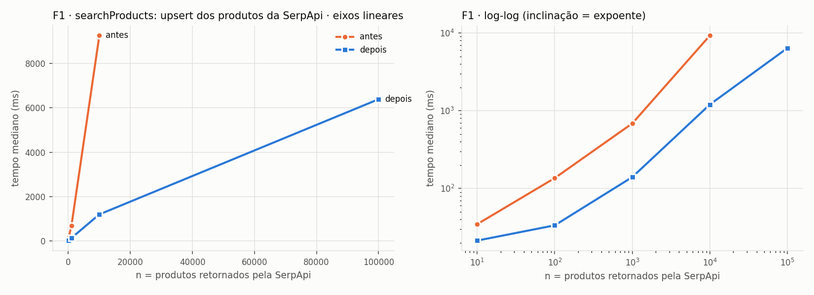
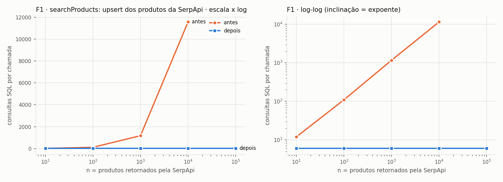

**Formato observado versus previsto.**
- **Consultas:** o gráfico é a evidência mais limpa. "Antes" cresce linearmente com inclinação ≈ 1 no log-log, e "depois" é uma reta horizontal em 6.
- **Por que o original faz menos que 2n consultas:** o Prisma agrupa `findUnique` concorrentes do mesmo *tick* numa só consulta (dataloader). Isso é constante e não muda a classe.
- **Tempo:** as duas curvas são lineares a partir de n ≈ 1.000, como previsto. O trabalho por linha domina quando n cresce. A diferença está no coeficiente: ≈ c_rt por produto antes e ≈ c_row por produto depois.
- **n pequeno:** a versão nova fica praticamente plana, dominada pelas 6 idas. Esse é o regime real do sistema (n ≤ 24).
- **Limite da medição:** a versão original não foi medida com n = 100.000. A razão medida de 1,16 consulta por produto (11.581 consultas para n = 10.000) projeta cerca de 116 mil idas por repetição, mais o seed de 100 mil linhas a cada repetição.
- Com n = 10.000 a versão nova é 7,7× mais rápida.
- O ajuste linear dá b ≈ 929 µs por produto antes (cerca de uma ida ao banco por produto) e b ≈ 63 µs depois (custo de ler e escrever uma linha), ambos com R² ≥ 0,99. As duas versões são lineares em tempo, com coeficiente cerca de 15× menor na nova.
- A inclinação de 0,73 da versão nova entre 10⁴ e 10⁵ é ruído entre rodadas (outra rodada deu 1,14); o ajuste sobre todos os pontos é a leitura mais estável.

### F2 — URLs de produtos excluídos na busca (`searchProducts` → `deletedProducts`)

**Responsável:** Vithor dos Santos
**Arquivos:** `backend/src/services/productService.ts`, `backend/src/services/productUrl.ts`, `backend/prisma/migrations/20261014120000_add_normalized_product_url/`, `backend/scripts/backfillNormalizedProductUrl.ts`

**Antes**

```ts
const deletedProducts = await prisma.product.findMany({
  where: { isDeleted: true },
  select: { productUrl: true, name: true, storeName: true }
});
const deletedUrls = new Set(
  deletedProducts.map((product) => normalizeProductUrl(product.productUrl)).filter((value) => value.length > 0)
);
```

**Depois**

```ts
export async function findDeletedProductUrls(normalizedUrls: string[]): Promise<Set<string>> {
  const candidates = Array.from(new Set(normalizedUrls.filter((value) => value.length > 0)));
  if (candidates.length === 0) {
    return new Set();
  }
  const deletedProducts = await prisma.product.findMany({
    where: { isDeleted: true, normalizedProductUrl: { in: candidates } },
    select: { normalizedProductUrl: true }
  });
  return new Set(deletedProducts.map((product) => product.normalizedProductUrl as string));
}
```

**Definição de n.** São três tamanhos:
- **D:** produtos excluídos no banco;
- **N:** total de produtos (N ≥ D);
- **n:** produtos da página (n ≤ 24).

A variável da análise e do gráfico é **D**, com a página fixa em 24 itens.

**Contagem de operações — antes.**

| Linha | Custo | Execuções |
|---|---|---|
| `findMany isDeleted` (sem índice: varre a tabela) | c_rt + c_scan·N + c_row·D | 1 |
| `normalizeProductUrl` (`new URL`, minúsculas) | c_url | D |
| `filter` + inserir no Set | c_set | D |
| teste `deletedUrls.has` por item da página | c_has | n |

T_antes(D, n) = c_rt + c_scan·N + (c_row + c_url + c_set)·D + c_has·n = Θ(N + D + n), com N ≥ D.

Não há variação entre melhor e pior caso em D: todas as D linhas são sempre lidas, transferidas e normalizadas. Então T = Θ(D + n) quando N = Θ(D), e O = Ω = Θ.

**Contagem de operações — depois.**

| Linha | Custo | Execuções |
|---|---|---|
| normalizar as URLs da página | c_url | n |
| deduplicar candidatas | c_set | n |
| `findMany ... IN (candidatas)` com índice `(isDeleted, normalizedProductUrl)` | c_rt + c_idx·log N por candidata + c_row por linha devolvida | 1 consulta, ≤ n sondagens |
| Set do resultado | c_set | ≤ n |

T_depois(D, n) = c_rt + n(c_url + 2c_set + c_idx·log N + c_row) = O(n log N).

Em função de D (com n fixo), o tempo é O(log N), que é O(log D) quando N = Θ(D). D deixa de aparecer de forma linear.

- **Melhor caso:** nenhuma URL na página, então não há consulta: Θ(n).
- **Pior caso:** n candidatas, O(n log N).

Θ não se aplica à função como um todo porque os dois casos diferem. Para a página real (n ≤ 24), o custo é limitado por O(log N).

**O, Ω e Θ.** Antes Θ(D + n); depois O(n log N) e Ω(n). **Mudança de classe** em D: de linear para logarítmica, via índice (meta B).

**Espaço.**
- Antes: Θ(D), entre linhas transferidas e o Set de todas as URLs excluídas.
- Depois: Θ(n).
- **Custo persistente, separado do espaço da função:** a coluna `normalizedProductUrl` e o índice composto ocupam Θ(N) no banco. É armazenamento do schema, pago uma vez e mantido em O(1) por escrita. Não é espaço auxiliar da função.

**Corretude e equivalência.**
- A normalização (`new URL` → `origin + pathname + search`, minúsculas, com fallback para `trim().toLowerCase()`) não é reproduzível com fidelidade em SQL. Por isso ela é calculada **em JS, pela mesma função**, em todo ponto de escrita: `createProduct`, `updateProduct`, `upsertProduct` e o lote da F1.
- `""` vira `NULL`, assim como o original descartava valores vazios. No `updateProduct`, `undefined` mantém o valor atual.
- Como a filtragem original só testava as URLs da página contra o conjunto, restringir o conjunto às URLs da página dá exatamente o mesmo resultado.
- O script `npm run db:backfill-normalized-url` (em `backend/scripts/`) preenche as linhas existentes.

Testes:
- `tests/equivalence/searchProducts.test.ts`, com 200 excluídos e 70% de acerto de URL em variações de caixa e fragmento;
- `tests/equivalence/backfillNormalizedProductUrl.test.ts`;
- `tests/unit/productService.normalizedUrl.test.ts`;
- `tests/unit/productUrl.test.ts`.

**Medição.** A consulta é medida isoladamente: o bloco original versus `findDeletedProductUrls`, mais o teste da página.

| n | antes (ms) | depois (ms) | antes ÷ depois | consultas antes | consultas depois |
|---|---|---|---|---|---|
| 10 | 2,75 | 2,79 | 1,0× | 1 | 1 |
| 100 | 4,62 | 2,89 | 1,6× | 1 | 1 |
| 1.000 | 12,1 | 3,82 | 3,2× | 1 | 1 |
| 10.000 | 63,1 | 3,01 | 21,0× | 1 | 1 |
| 100.000 | 596 | 5,38 | 110,6× | 1 | 1 |

Inclinação no log-log entre os dois maiores n medidos (tempo): antes: 0,97; depois: 0,25.

Ajuste linear t(n) = a + b·n por mínimos quadrados sobre todos os pontos:

- antes: a = 4,21 ms, b = 5,9134 µs por unidade de n, R² = 1,000
- depois: a = 3,07 ms, b = 0,0229 µs por unidade de n, R² = 0,847

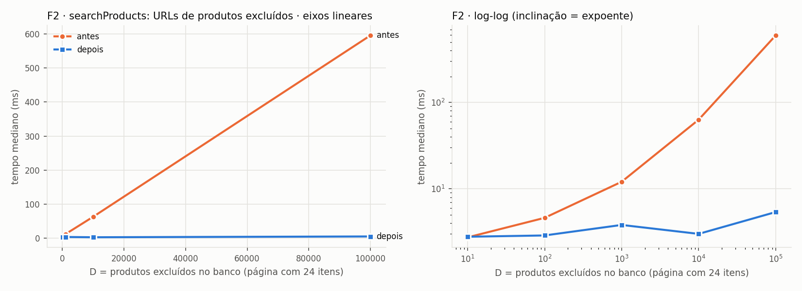

**Formato observado versus previsto.**
- "Antes" é linear em D: o ajuste a + b·D tem R² perto de 1 e b de alguns µs por linha excluída (transferir e normalizar cada linha). A inclinação entre os dois maiores D fica um pouco abaixo de 1 por causa do custo fixo a da ida ao banco (ver "Como ler as medições").
- "Depois" tem b ≈ 0 no ajuste: o custo não depende de D. O fator log N do índice não aparece nessa faixa, porque a árvore B tem 3 ou 4 níveis. As variações de poucos milissegundos são ruído de medição.
- Para D pequeno (10–100) as curvas coincidem, porque a ida ao banco (c_rt) domina.

**Busca completa (F2b).** Também medimos o `searchProducts` inteiro com D crescente.
- "Antes" chega a 523 ms com D = 100.000, dominado por trazer e normalizar as D linhas.
- "Depois" fica entre 28 e 57 ms (b ≈ 0,28 µs por linha contra 4,5 µs antes). A pequena variação que resta não vem da F2: o `count`/`findMany` com `ILIKE '%q%'` da F6 varre a tabela toda, inclusive as D linhas excluídas (seção F6). Esse custo por linha é muito menor que o de transferir e normalizar no Node.

| n | antes (ms) | depois (ms) | antes ÷ depois | consultas antes | consultas depois |
|---|---|---|---|---|---|
| 10 | 79,1 | 29,4 | 2,7× | 33 | 12 |
| 100 | 69,8 | 29,9 | 2,3× | 31 | 12 |
| 1.000 | 72,4 | 28,1 | 2,6× | 32 | 12 |
| 10.000 | 95,3 | 37,2 | 2,6× | 35 | 12 |
| 100.000 | 523 | 57,4 | 9,1× | 36 | 13 |

Inclinação no log-log entre os dois maiores n medidos (tempo): antes: 0,74; depois: 0,19.

Ajuste linear t(n) = a + b·n por mínimos quadrados sobre todos os pontos:

- antes: a = 66,93 ms, b = 4,5455 µs por unidade de n, R² = 0,997
- depois: a = 30,27 ms, b = 0,2753 µs por unidade de n, R² = 0,960

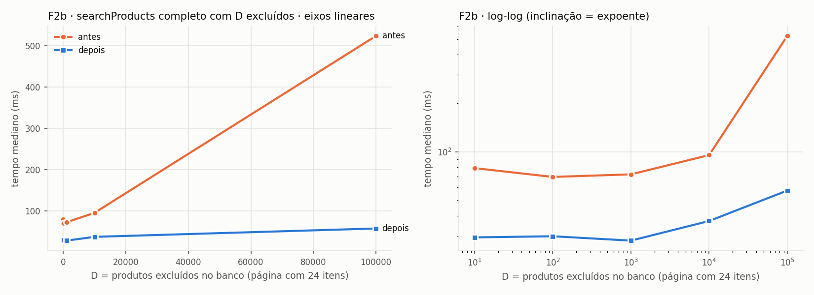

### F3 — validação da loja em `createProduct`

**Responsável:** Paulo Ricardo
**Arquivos:** `backend/src/services/productService.ts`, `backend/prisma/migrations/20261014130000_add_store_active_lower_name_index/`

**Antes**

```ts
const activeStores = await prisma.store.findMany({ where: { isActive: true }, select: { name: true } });
if (activeStores.length === 0) {
  throw new Error("Cadastre ao menos uma loja ativa antes de criar um produto.");
}
const normalizedStoreName = input.storeName?.trim() || "";
if (!normalizedStoreName) {
  throw new Error("Selecione uma loja ativa para cadastrar o produto.");
}
const storeExists = activeStores.some((store) => store.name.toLowerCase() === normalizedStoreName.toLowerCase());
if (!storeExists) {
  throw new Error("A loja selecionada não está ativa ou não existe.");
}
const ownedStore = await prisma.store.findFirst({
  where: { name: { equals: normalizedStoreName, mode: "insensitive" }, userId: input.ownerUserId, isActive: true },
  select: { id: true }
});
```

**Depois**

```ts
if (!(await hasAnyActiveStore())) {
  throw new Error("Cadastre ao menos uma loja ativa antes de criar um produto.");
}
const normalizedStoreName = input.storeName?.trim() || "";
if (!normalizedStoreName) {
  throw new Error("Selecione uma loja ativa para cadastrar o produto.");
}
if (!(await hasActiveStoreNamed(normalizedStoreName))) {
  throw new Error("A loja selecionada não está ativa ou não existe.");
}
if (!(await ownsActiveStoreNamed(normalizedStoreName, input.ownerUserId))) {
  throw new Error("Selecione uma loja ativa criada por voce.");
}
```

As novas consultas são:
- `hasAnyActiveStore`: `SELECT 1 FROM "Store" WHERE "isActive" LIMIT 1`;
- `hasActiveStoreNamed`: `... WHERE "isActive" AND lower("name") = lower($1) LIMIT 1`, que usa o índice funcional parcial `CREATE INDEX "Store_active_lower_name_idx" ON "Store" (lower("name")) WHERE "isActive"`;
- `ownsActiveStoreNamed`: quando o nome não contém `\`, primeiro `... AND "userId" = $2` pelo mesmo índice; só se isso não encontrar nada, cai no `ILIKE` original.

Categoria, URL duplicada e criação ficaram iguais.

**Definição de n.** S é o número de lojas no banco. Nos benchmarks, 90% delas estão ativas e cada usuário é dono de metade.

**Contagem de operações — antes.**

| Linha | Custo | Execuções |
|---|---|---|
| `findMany` das lojas ativas (seq scan, ver EXPLAIN) | c_rt + c_scan·S + c_row·S_a | 1 |
| `.some` com dois `toLowerCase` por loja | c_cmp·m | até S_a (m = tamanho do nome) |
| `findFirst ... ILIKE` do dono (seq scan) | c_rt + c_scan·S | 1 |

T_antes(S) = 2c_rt + 2c_scan·S + c_row·S_a + c_cmp·m·j, onde j ≤ S_a é a posição da loja encontrada.

- **Melhor caso:** j = 1, mas as S_a linhas já foram transferidas, então continua Θ(S).
- **Pior caso:** j = S_a, também Θ(S).

T_antes = Θ(S).

**Contagem de operações — depois (caminho de sucesso).**

| Linha | Custo | Execuções |
|---|---|---|
| existe loja ativa (`LIMIT 1`, para no 1º registro ativo) | c_rt + c₁ | 1 |
| loja ativa pelo nome (índice parcial) | c_rt + c_idx·log S + r | 1 |
| dono por igualdade (mesmo índice + filtro `userId`) | c_rt + c_idx·log S + r | 1 |

T_depois = 3c_rt + 2c_idx·log S + O(r), onde r é o número de lojas ativas com o mesmo nome em minúsculas (O(1) na prática). Logo T_depois = O(log S) no caminho de sucesso.

- **Pior caso:** quando a igualdade não encontra o dono (o usuário não é dono, ou o nome contém `\`), cai no `ILIKE` original, que varre Θ(S).
- Também é Θ(S) o caso em que não existe loja ativa e o planejador escolhe o seq scan. Com estatísticas atualizadas ele tende a usar o índice parcial.
- **Melhor caso:** O(1) quando não há nome (validação 2).

Melhor e pior caso diferem, então **Θ não se aplica** à função inteira. O caminho que cria produtos é O(log S), e os caminhos de erro de dono podem ser Θ(S).

**O, Ω e Θ.** Antes Θ(S); depois O(S) no pior caso, mas O(log S) no caminho de sucesso. O caminho que efetivamente cadastra o produto **muda de classe**: de linear para logarítmico (meta B).

**Espaço.**
- Antes: Θ(S), com as linhas de todas as lojas ativas na aplicação.
- Depois: Θ(1).
- O índice parcial ocupa Θ(S_a) no banco, como armazenamento persistente.

**Corretude e equivalência.** Ordem das validações e mensagens idênticas.
- **Etapa 3:** o original comparava com `toLowerCase()` do JS sobre as lojas ativas de **todos** os usuários, com o nome armazenado sem `trim` e a entrada com `trim`. A versão nova usa `lower()` do Postgres com a mesma assimetria. Medimos os dois em 1.215 code points (latino, grego e cirílico, U+0020–U+04FF) no Postgres 16 do `docker-compose` (`datctype en_US.utf8`). Só divergem `İ` (U+0130) e o sigma final contextual grego (achado A3). Todos os acentos do pt-BR coincidem.
- **Etapa 4:** o original usa `ILIKE` sem escapar a entrada (`%` e `_` viram curingas). Se o nome não tem `\` e existe uma loja ativa do usuário com `lower(name) = lower(entrada)`, então essa loja também casa com `ILIKE entrada`: um texto sempre casa consigo mesmo como padrão, e `%`/`_` casam com os próprios caracteres. Logo a resposta "existe" é a mesma. Quando a igualdade falha, a consulta original é executada sem alterações.

Testes:
- `tests/equivalence/createProduct.test.ts`, no banco real, com 24 cenários (acentos, caixa, curingas, barra invertida, loja de outro usuário, nomes com espaços, categoria, URL duplicada) e mais um teste com 300 homônimos inativos;
- `tests/unit/productService.createProduct.test.ts`.

**EXPLAIN** (S = 100.000, de `docs/complexidade/dados/f3_explain.txt`):

```
-- antes: findMany de todas as lojas ativas
Seq Scan on "Store"  (cost=0.00..3029.00 rows=89927 width=20) (actual rows=90000 loops=1)
  Filter: "isActive"
  Rows Removed by Filter: 10000
  Buffers: shared hit=2029
Planning Time: 0.079 ms
Execution Time: 13.418 ms

-- antes: loja ativa do usuário por ILIKE
Limit  (cost=0.00..882.25 rows=1 width=37) (actual rows=1 loops=1)
  Buffers: shared hit=2029
  ->  Seq Scan on "Store"  (cost=0.00..3529.00 rows=4 width=37) (actual rows=1 loops=1)
        Filter: ("isActive" AND (name ~~* 'loja benchmark 99998'::text) AND ("userId" = 'u1'::text))
        Rows Removed by Filter: 99998
        Buffers: shared hit=2029
Planning Time: 0.216 ms
Execution Time: 53.598 ms

-- depois: existe loja ativa
Limit  (cost=0.00..0.03 rows=1 width=4) (actual rows=1 loops=1)
  Buffers: shared hit=1
  ->  Seq Scan on "Store"  (cost=0.00..3029.00 rows=89927 width=4) (actual rows=1 loops=1)
        Filter: "isActive"
        Rows Removed by Filter: 1
        Buffers: shared hit=1
Planning Time: 0.043 ms
Execution Time: 0.012 ms

-- depois: loja ativa pelo nome
Limit  (cost=0.42..1.73 rows=1 width=4) (actual rows=1 loops=1)
  Buffers: shared hit=4
  ->  Index Scan using "Store_active_lower_name_idx" on "Store"  (cost=0.42..592.45 rows=450 width=4) (actual rows=1 loops=1)
        Index Cond: (lower(name) = 'loja benchmark 99998'::text)
        Buffers: shared hit=4
Planning Time: 0.046 ms
Execution Time: 0.052 ms

-- depois: loja ativa do usuário pelo nome
Limit  (cost=0.42..3.07 rows=1 width=4) (actual rows=1 loops=1)
  Buffers: shared hit=4
  ->  Index Scan using "Store_active_lower_name_idx" on "Store"  (cost=0.42..593.58 rows=224 width=4) (actual rows=1 loops=1)
        Index Cond: (lower(name) = 'loja benchmark 99998'::text)
        Filter: ("userId" = 'u1'::text)
        Buffers: shared hit=4
Planning Time: 0.049 ms
Execution Time: 0.038 ms
```

**Medição.**

| n | antes (ms) | depois (ms) | antes ÷ depois | consultas antes | consultas depois |
|---|---|---|---|---|---|
| 10 | 10,6 | 13,6 | 0,8× | 3 | 4 |
| 100 | 11,5 | 10,5 | 1,1× | 3 | 4 |
| 1.000 | 15,3 | 10,1 | 1,5× | 3 | 4 |
| 10.000 | 58,4 | 12,1 | 4,8× | 3 | 4 |
| 100.000 | 294 | 10,5 | 27,9× | 3 | 4 |

Inclinação no log-log entre os dois maiores n medidos (tempo): antes: 0,70; depois: -0,06.

Ajuste linear t(n) = a + b·n por mínimos quadrados sobre todos os pontos:

- antes: a = 15,81 ms, b = 2,7986 µs por unidade de n, R² = 0,995
- depois: a = 11,58 ms, b = -0,0099 µs por unidade de n, R² = 0,089

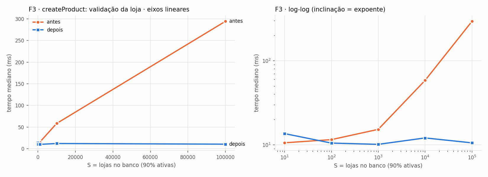

**Formato observado versus previsto.**
- "Antes" é linear em S: R² perto de 1 no ajuste a + b·S, com as duas varreduras e a transferência de S_a nomes.
- A inclinação entre os dois maiores S fica abaixo de 1 porque o intercepto a (3 idas ao banco) ainda pesa frente a b·S (ver "Como ler as medições").
- "Depois" tem b ≈ 0 (ou ligeiramente negativo, dentro do ruído): custo constante em S, como prevê o O(log S) com árvore B rasa.
- O número de consultas sobe de 3 para 4: uma ida a mais, constante, em troca de não varrer a tabela.

### F4 — favorito de um produto na página de detalhe (`loadProduct`)

**Responsável:** Paulo Ricardo
**Arquivos:** `frontend/src/pages/ProductDetailPage.tsx`, `frontend/src/services/api.ts`, `backend/src/services/favoriteService.ts`, `backend/src/controllers/favoriteController.ts`, `backend/src/routes/favoriteRoutes.ts`

**Antes**

```ts
const favorites = await listFavorites();
const match = favorites.find((fav) => fav.product.id === apiProduct.id);
setIsFavorite(Boolean(match));
setFavoriteId(match?.id ?? null);
```

**Depois**

```ts
const match = await getFavoriteForProduct(apiProduct.id);
setIsFavorite(Boolean(match));
setFavoriteId(match?.id ?? null);
```

```ts
export async function findFavoriteForProduct(userId: string, productId: string) {
  return prisma.favorite.findUnique({
    where: { userId_productId: { userId, productId } },
    select: { id: true, productId: true }
  });
}
```

Endpoint novo: `GET /favorites/product/:productId`, autenticado, que devolve `{ id, productId }` ou `null`.

**Definição de n.** F é o número de favoritos do usuário logado.

**Contagem de operações — antes.**

| Linha | Custo | Execuções |
|---|---|---|
| `GET /favorites`: `findMany` por `userId` (índice) | c_rt + c_idx·log N + c_row·F | 1 |
| `include product`: 2ª consulta `IN (F ids)` | c_rt + c_idx·F·log N + c_row·F | 1 |
| serializar, transferir e parsear o JSON (~600 bytes/favorito) | c_json | F |
| `find` no front | c_cmp | até F |

T_antes(F) = 2c_rt + Θ(F log N) no banco + Θ(F) de transferência e parsing.

- **Melhor caso:** o produto é o primeiro da lista, mas as F linhas já foram baixadas.
- **Pior caso:** o produto não é favorito, e o `find` percorre as F linhas.

Em ambos os casos o custo é Θ(F) (desconsiderando o log N do índice, que é igual nos dois cenários).

**Contagem de operações — depois.**

| Linha | Custo | Execuções |
|---|---|---|
| `findUnique` no índice único `(userId, productId)` | c_rt + c_idx·log N_fav | 1 |
| serializar e transferir `{ id, productId }` ou `null` | c_json | 1 |

T_depois(F) = c_rt + c_idx·log N_fav + c = O(log N_fav). Como o índice cobre todos os favoritos do sistema (N_fav ≥ F), o custo é O(log N_fav), que é O(log F) quando um único usuário domina a tabela, como no benchmark. Melhor e pior caso coincidem: O = Ω = Θ(log N_fav).

**O, Ω e Θ.** Θ(F) → Θ(log N_fav). **Mudança de classe** (meta B).

**Espaço.**
- Antes: Θ(F), com o JSON da lista inteira no back e no front.
- Depois: Θ(1).

**Corretude e equivalência.**
- `isFavorite` e `favoriteId` saem dos mesmos dados: o índice único `(userId, productId)` garante no máximo um favorito por par, então "o primeiro da lista com aquele produto" e "o único com aquele produto" coincidem.
- Em erro (inclusive usuário sem login, que recebe 401 nos dois endpoints), o `catch` continua definindo `false` e `null`.

Testes:
- `frontend/tests/unit/pages/favoritesLookup.equivalence.test.tsx`: um backend falso único, o mesmo teste verde contra a versão antiga e a nova, cobrindo favoritado, não favoritado e falha;
- `frontend/tests/unit/pages/ProductDetailPage.test.tsx`;
- `backend/tests/integration/routes/favoriteRoutes.test.ts`, que cobre 401, encontrado e não encontrado;
- `backend/tests/unit/favoriteService.test.ts` e `favoriteController.test.ts`.

**Medição.** Medido no service do back, com F favoritos de um usuário. A coluna "bytes" é o tamanho do JSON que o endpoint envia ao front.

| n | antes (ms) | depois (ms) | antes ÷ depois | consultas antes | consultas depois | bytes antes | bytes depois |
|---|---|---|---|---|---|---|---|
| 10 | 3,61 | 2,57 | 1,4× | 2 | 1 | 6.001 | 96 |
| 100 | 5,47 | 3,10 | 1,8× | 2 | 1 | 60.461 | 96 |
| 1.000 | 92,3 | 3,33 | 27,7× | 2 | 1 | 609.551 | 96 |
| 10.000 | 459 | 2,98 | 153,8× | 2 | 1 | 6.145.451 | 96 |
| 100.000 | 4.726 | 3,09 | 1527,2× | 5 | 1 | 61.954.451 | 96 |

Inclinação no log-log entre os dois maiores n medidos (tempo): antes: 1,01; depois: 0,02.

Ajuste linear t(n) = a + b·n por mínimos quadrados sobre todos os pontos:

- antes: a = 9,61 ms, b = 47,1502 µs por unidade de n, R² = 1,000
- depois: a = 2,99 ms, b = 0,0011 µs por unidade de n, R² = 0,027

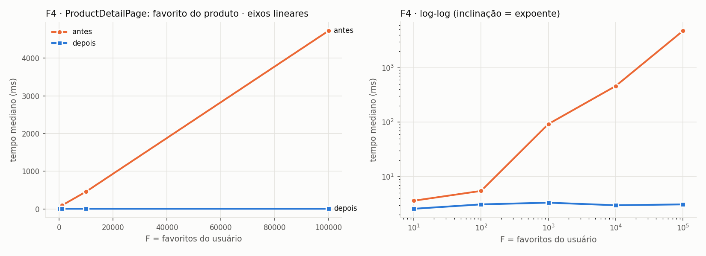
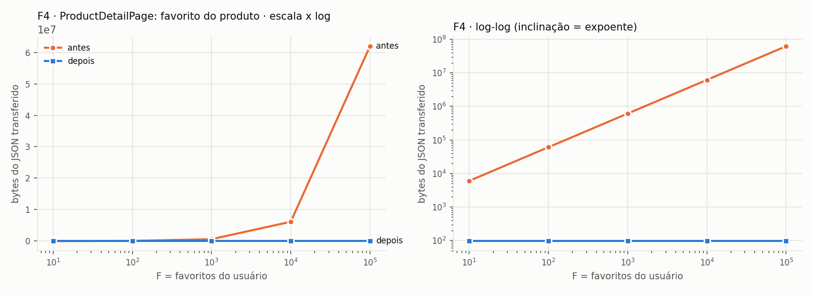

**Formato observado versus previsto.**
- "Antes" é linear em F a partir de F ≈ 1.000, em tempo e em bytes. A inclinação dos bytes no log-log é ≈ 1,00.
- "Depois" é constante: 96 bytes e alguns milissegundos, que são a ida ao banco.
- Para F ≤ 100, as duas versões ficam na faixa da latência.
- Com F = 100.000, a versão antiga faz 5 consultas em vez de 2. O Prisma fatia o `IN` do `include` em lotes de até 32.766 parâmetros (achado A10). A classe não muda.

### F5 — favoritos da página de busca e da vitrine (`loadSearchResults`, `loadShowcase`)

**Responsável:** Vithor dos Santos
**Arquivos:** `frontend/src/pages/HomePage.tsx`, `frontend/src/services/api.ts`, `backend/src/services/favoriteService.ts`, `backend/src/controllers/favoriteController.ts`, `backend/src/routes/favoriteRoutes.ts`

**Antes**

```ts
const favorites = await listFavorites();
const favoritesByProduct = new Map(favorites.map((item) => [item.product.id, item.id]));
```

**Depois**

```ts
async function fetchFavoritesByProduct(resultProducts: Product[]) {
  const pageProductIds = resultProducts.slice(0, SEARCH_PAGE_SIZE).map((product) => product.id);
  const favorites = await lookupFavorites(pageProductIds);
  return new Map(favorites.map((item) => [item.productId, item.id]));
}
```

```ts
export async function findFavoritesForProducts(userId: string, productIds: string[]) {
  if (productIds.length === 0) {
    return [];
  }
  return prisma.favorite.findMany({
    where: { userId, productId: { in: productIds } },
    select: { id: true, productId: true }
  });
}
```

Endpoint novo: `POST /favorites/lookup` com `{ productIds }`, autenticado, que aceita até 100 ids (ids inválidos → 400). `GET /favorites` sem parâmetros continua igual para as outras telas.

**Definição de n.** F é o número de favoritos do usuário; k é o número de produtos exibidos (k ≤ 8).

**Contagem de operações — antes.**

| Linha | Custo | Execuções |
|---|---|---|
| `GET /favorites` (2 consultas, F linhas, F produtos) | 2c_rt + Θ(F log N) + c_row·F | 1 |
| transferir e parsear ~600 bytes por favorito | c_json | F |
| montar o `Map` | c_map | F |
| `has`/`get` por card | c_get | 2k |

T_antes(F, k) = Θ(F + k), igual no melhor e no pior caso, já que a lista inteira sempre é baixada. Então O = Ω = Θ(F + k).

**Contagem de operações — depois.**

| Linha | Custo | Execuções |
|---|---|---|
| `findMany ... IN (k ids)` no índice `(userId, productId)` | c_rt + c_idx·k·log N_fav + c_row·r | 1 (r ≤ k linhas) |
| transferir `{ id, productId }` | c_json | r |
| montar o `Map` e consultar por card | c_map + c_get | r + 2k |

T_depois(F, k) = c_rt + O(k log N_fav) = O(k log F), com N_fav = Θ(F) como no benchmark.

- **Melhor caso:** k = 0, sem consulta ao banco (o endpoint é chamado mesmo assim, para preservar o 401).
- **Pior caso:** O(k log N_fav).

Θ não se aplica entre esses extremos. Para k fixo (8), o custo é O(log N_fav), independente de F.

**O, Ω e Θ.** Θ(F + k) → O(k log F). **Mudança de classe** em F (meta B).

**Espaço.** Antes Θ(F) (JSON e `Map` de todos os favoritos); depois Θ(k).

**Corretude e equivalência.**
- Os cards só consultam o `Map` pelos ids dos 8 primeiros produtos (`normalizeProducts` faz `slice(0, 8)`), então um `Map` restrito a esses ids responde igual.
- **Assimetria preservada** (achado A1): em `loadSearchResults`, a falha ao buscar favoritos tem `try` próprio e vira `Map` vazio. Em `loadShowcase` não há `try` próprio, então a falha derruba a vitrine inteira com "Não foi possível carregar os resultados agora. Tente novamente.".
- O front chama o endpoint **sempre**, mesmo com 0 ids, para que o 401 de quem não está logado continue derrubando a vitrine como antes.

Testes:
- `frontend/tests/unit/pages/favoritesLookup.equivalence.test.tsx`: busca com favoritos, falha na busca, vitrine com favoritos, vitrine com falha e vitrine vazia com falha;
- `frontend/tests/unit/pages/HomePage.test.tsx`;
- os testes de rota e de service do back.

**Medição.** Service do back com F favoritos e uma página de 8 ids, sendo 4 favoritos.

| n | antes (ms) | depois (ms) | antes ÷ depois | consultas antes | consultas depois | bytes antes | bytes depois |
|---|---|---|---|---|---|---|---|
| 10 | 2,84 | 3,00 | 0,9× | 2 | 1 | 6.001 | 389 |
| 100 | 8,39 | 2,07 | 4,0× | 2 | 1 | 60.461 | 389 |
| 1.000 | 95,6 | 3,78 | 25,3× | 2 | 1 | 609.551 | 389 |
| 10.000 | 404 | 2,95 | 137,1× | 2 | 1 | 6.145.451 | 389 |
| 100.000 | 4.475 | 4,46 | 1003,5× | 5 | 1 | 61.954.451 | 389 |

Inclinação no log-log entre os dois maiores n medidos (tempo): antes: 1,04; depois: 0,18.

Ajuste linear t(n) = a + b·n por mínimos quadrados sobre todos os pontos:

- antes: a = 4,78 ms, b = 44,6578 µs por unidade de n, R² = 1,000
- depois: a = 2,91 ms, b = 0,0155 µs por unidade de n, R² = 0,558

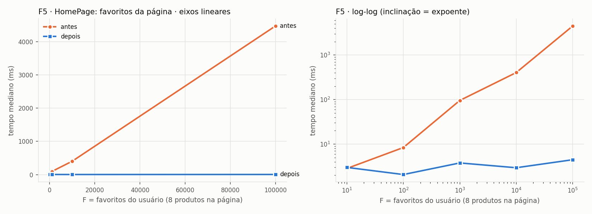
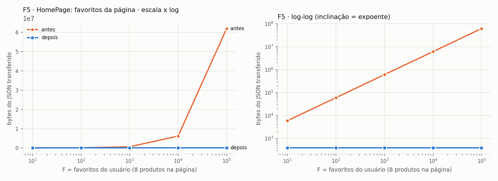

**Formato observado versus previsto.** Igual ao da F4: "antes" é linear em F, em tempo e bytes, e "depois" é constante (389 bytes para os 4 favoritos da página).

### F6 — produtos locais na busca (`searchProducts` → `localMatches`)

**Responsável:** Paulo Ricardo
**Arquivo:** `backend/src/services/productService.ts`

**Antes**

```ts
const localMatches = await prisma.product.findMany({ where: localWhere, orderBy: { createdAt: "desc" }, select: { ... } });
const localDtos = localMatches.map(mapSavedProduct);
const mergedByExternalId = new Map<string, ProductDTO>();
for (const local of localDtos) mergedByExternalId.set(local.externalId, local);
for (const external of productsToReturn.filter(Boolean) as ProductDTO[]) {
  if (!mergedByExternalId.has(external.externalId)) mergedByExternalId.set(external.externalId, external);
}
const mergedProducts = Array.from(mergedByExternalId.values());
const paginatedProducts = mergedProducts.slice(0, limit);
// hasNextPage: searchResult.hasNextPage || mergedProducts.length > limit
// totalResults: totalResults ?? mergedProducts.length
```

**Depois**

```ts
const [localMatches, localCount] = await Promise.all([
  prisma.product.findMany({ where: localWhere, orderBy: { createdAt: "desc" }, take: limit, select: { ... } }),
  prisma.product.count({ where: localWhere })
]);
const externalOnly = Array.from(externalByExternalId.values()).filter((external) => !localExternalIds.has(external.externalId));
const paginatedProducts = [...localDtos, ...externalOnly].slice(0, limit);
const knowsAllLocals = localCount <= limit;
const knownMergedCount = localDtos.length + externalOnly.length;
const exceedsLimit = !knowsAllLocals || knownMergedCount > limit;
let totalResults = searchResult.totalResults;
if (totalResults === undefined || totalResults === null) {
  totalResults = knowsAllLocals
    ? knownMergedCount
    : await countMergedProducts(localWhere, localCount, Array.from(externalByExternalId.keys()));
}
```

`countMergedProducts` faz `count(localWhere AND externalId IN externos distintos)` e devolve `L + distintos − sobreposição`.

**Definição de n.** São quatro tamanhos:
- **L:** produtos locais (não excluídos) que casam com o termo ou a categoria;
- **k:** o `limit` (8 a 24);
- **n:** externos da página;
- **N:** total de produtos na tabela.

**Contagem de operações — antes.**

| Linha | Custo | Execuções |
|---|---|---|
| `findMany` com `ILIKE '%q%'` (seq scan) e ordenação | c_rt + c_scan·N + c_sort·L log L | 1 |
| `include priceHistory`: 2ª consulta com `IN (L ids)` | c_rt + Θ(L + H_L) | 1 |
| transferir e mapear L linhas (`mapSavedProduct`) | c_row + c_map | L |
| `Map` de mesclagem | c_set | L + n |
| `slice` | c | k |

T_antes = Θ(N + L log L) no banco + Θ(L + n) na aplicação. É o mesmo nos dois extremos, já que o resultado é sempre carregado por inteiro.

**Contagem de operações — depois.**

| Linha | Custo | Execuções |
|---|---|---|
| `findMany ... take k` (seq scan com top-k) | c_rt + c_scan·N + c_heap·L log k | 1 |
| `include priceHistory` com `IN (k ids)` | c_rt + Θ(k + H_k) | 1 |
| `count(localWhere)` (seq scan) | c_rt + c_scan·N | 1 |
| `count` de sobreposição, só se L > k e a SerpApi não informa o total | c_rt + c_scan·N | 0 ou 1 |
| transferir e mapear k linhas; mesclar com n externos | c_row + c_map + c_set | k + n |

T_depois = Θ(N + L log k) no banco + Θ(k + n) na aplicação.

**O, Ω e Θ.**
- **Na aplicação** (linhas transferidas, objetos criados e memória): Θ(L) → Θ(k + n), com k ≤ 24 e n ≤ 24.
- **No banco**, o termo dominante continua sendo a varredura Θ(N) do `ILIKE '%q%'`. Nenhum índice B-tree atende a um padrão com `%` à esquerda. Por isso **F6 não conta para a meta B**: a classe da função como um todo, dominada pelo banco, continua linear.
- Um índice trigram (`pg_trgm` + GIN) poderia tornar a busca sublinear; fica como trabalho futuro.

**Espaço.** Na aplicação, Θ(L) → Θ(k + n). No banco, o top-k usa Θ(k) em vez de ordenar L linhas.

**Corretude e equivalência.**
- **L ≤ k:** o `findMany` com `take` traz todos os locais, então a mesclagem e o total são calculados exatamente como antes.
- **L > k:** os k primeiros produtos da página são os k primeiros locais, porque os locais vêm antes dos externos e os `externalId` locais são únicos. Então `slice(0, k)` coincide.
  - `hasNextPage` é verdadeiro nas duas versões, já que `merged.length ≥ L > k`.
  - O total exato `L + |externos distintos ∖ locais|` só é necessário quando a SerpApi não informa o total, e vem da contagem de sobreposição.
- **Empates de `createdAt`:** a ordem entre empates não é especificada em nenhuma das duas versões (a consulta é a mesma, `ORDER BY createdAt DESC`). Os testes usam `createdAt` distintos.

Testes:
- `tests/equivalence/searchProducts.test.ts`: 19 cenários × 3 sementes, com L < k, L = k, L = k+1, L ≫ k, sobreposição nula e alta, externos duplicados, total presente, ausente e zero, próxima página, limit 24, página 2, busca por categoria e só categoria;
- `tests/unit/productService.localMatches.test.ts`, que cobre os três ramos da contagem.

**Medição.** `searchProducts` completo, com L locais que casam, página de 8 itens, 8 externos (25% sobrepostos) e sem total da SerpApi, forçando o ramo da contagem de sobreposição.

| n | antes (ms) | depois (ms) | antes ÷ depois | consultas antes | consultas depois |
|---|---|---|---|---|---|
| 10 | 51,5 | 38,9 | 1,3× | 16 | 13 |
| 100 | 66,8 | 38,6 | 1,7× | 17 | 13 |
| 1.000 | 146 | 53,0 | 2,8× | 16 | 13 |
| 10.000 | 505 | 82,9 | 6,1× | 16 | 13 |
| 100.000 | — | 177 | — | — | 14 |

Inclinação no log-log entre os dois maiores n medidos (tempo): antes: 0,54; depois: 0,33.

Ajuste linear t(n) = a + b·n por mínimos quadrados sobre todos os pontos:

- antes: a = 71,00 ms, b = 43,6955 µs por unidade de n, R² = 0,989
- depois: a = 49,24 ms, b = 1,2948 µs por unidade de n, R² = 0,951

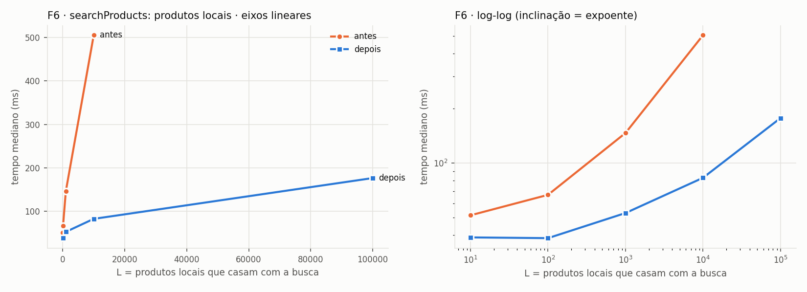

**Formato observado versus previsto.**
- "Antes" é linear em L: R² perto de 1 no ajuste a + b·L, com b de dezenas de µs por produto local (transferir e mapear cada linha com o histórico). A inclinação entre os dois maiores L fica bem abaixo de 1 porque o intercepto (cerca de 16 consultas, fetch à SerpApi e upserts) é grande frente a b·L até L = 10⁴.
- "Depois" também é linear, mas com b cerca de 34 vezes menor (1,3 contra 43,7 µs por produto local): é o seq scan do `ILIKE` nas duas ou três consultas, cada uma Θ(N), com custo por linha bem menor que transferir e mapear na aplicação.
- Isso é exatamente o que a análise prevê: a constante do banco por linha (varrer e comparar) é muito menor que a da aplicação (transferir, criar o objeto e mapear), mas a classe é a mesma.
- A versão original **falhou com L = 100.000**: o motor do Prisma 5.22 entrou em pânico (`no entry found for key`, `record.rs:69`) ao montar o `include` de 100 mil produtos (achado A11). Por isso a curva "antes" vai só até 10.000.

### F7 — métricas do Dashboard

**Responsável:** João Felipe da Rocha Soares
**Arquivos:** `frontend/src/lib/dashboardMetrics.ts` (extraído de `frontend/src/pages/DashboardPage.tsx`)

**Antes** (resumo; a cópia fiel está em `frontend/bench/legacy/dashboardMetrics.ts`)

```ts
const currentMonthHistory = priceHistory.filter((entry) => isInRange(entry.capturedAt, currentMonthStart, nextMonthStart));
const previousMonthHistory = priceHistory.filter((entry) => isInRange(entry.capturedAt, previousMonthStart, currentMonthStart));
const trackedItemsCurrent = new Set(currentMonthHistory.map((entry) => entry.productName)).size;
const trackedItemsPrevious = new Set(previousMonthHistory.map((entry) => entry.productName)).size;
const activeAlertsTotal = alerts.filter((alert) => alert.isActive).length;
const activeAlertsCurrent = alerts.filter((alert) => alert.isActive && isInRange(alert.createdAt, currentMonthStart, nextMonthStart)).length;
const activeAlertsPrevious = alerts.filter((alert) => alert.isActive && isInRange(alert.createdAt, previousMonthStart, currentMonthStart)).length;
const favoritesCurrent = favorites.filter((favorite) => isInRange(favorite.createdAt, currentMonthStart, nextMonthStart)).length;
const favoritesPrevious = favorites.filter((favorite) => isInRange(favorite.createdAt, previousMonthStart, currentMonthStart)).length;
const savingsTotal = priceHistory.reduce(...);
const savingsCurrent = currentMonthHistory.reduce(...);
const savingsPrevious = previousMonthHistory.reduce(...);
// no JSX: new Set(priceHistory.map((entry) => entry.productName)).size
```

**Depois**

```ts
for (const entry of priceHistory) {
  const saving = Math.max(0, Number(entry.oldPrice) - Number(entry.newPrice));
  const window = classify(entry.capturedAt, windows);
  allNames.add(entry.productName);
  savingsTotal = savingsTotal + saving;
  if (window === CURRENT) { currentNames.add(entry.productName); savingsCurrent = savingsCurrent + saving; }
  else if (window === PREVIOUS) { previousNames.add(entry.productName); savingsPrevious = savingsPrevious + saving; }
}
for (const alert of alerts) { ... }
for (const favorite of favorites) { ... }
```

**Definição de n.** São três tamanhos: h (entradas do histórico), a (alertas) e f (favoritos). O tamanho da entrada é n = h + a + f.

**Contagem de operações — antes.** Sejam h_c e h_p as entradas do mês corrente e do anterior (h_c + h_p ≤ h) e a⁺ os alertas ativos.

| Passada | Operações por elemento | Elementos |
|---|---|---|
| `filter` do mês corrente | 1 `new Date` + 2 comparações | h |
| `filter` do mês anterior | 1 `new Date` + 2 comparações | h |
| `map` + `Set` corrente | 2 | h_c |
| `map` + `Set` anterior | 2 | h_p |
| `filter` de ativos | 1 | a |
| `filter` de ativos do mês corrente | 1 + (`new Date` + 2) | a (o Date só para a⁺) |
| `filter` de ativos do mês anterior | 1 + (`new Date` + 2) | a |
| `filter` de favoritos do mês corrente | `new Date` + 2 | f |
| `filter` de favoritos do mês anterior | `new Date` + 2 | f |
| `reduce` da economia total | 3 | h |
| `reduce` da economia corrente | 3 | h_c |
| `reduce` da economia anterior | 3 | h_p |
| `map` + `Set` de todos os nomes (no JSX) | 2 | h |

Somando por coleção:
- **Histórico:** 3h + 3h (dois `filter`), + 2(h_c + h_p) ≤ 2h (dois `Set`), + 3h + 3(h_c + h_p) ≤ 6h (três `reduce`), + 2h (`Set` de todos). Total: 16h.
- **Alertas:** a + (a + 3a⁺) + (a + 3a⁺) ≤ 9a.
- **Favoritos:** 3f + 3f = 6f.

T_antes ≤ 16h + 9a + 6f, em 13 passadas: 8 sobre o histórico (algumas sobre subconjuntos), 3 sobre os alertas e 2 sobre os favoritos.

**Contagem de operações — depois.**

| Passada | Operações por elemento | Elementos |
|---|---|---|
| histórico: subtração e `max`, 1 `new Date`, até 4 comparações, até 2 `Set.add`, até 2 somas | ≤ 11 | h |
| alertas: 1 teste e, se ativo, 1 incremento, 1 `new Date`, até 4 comparações e 1 incremento | ≤ 8 | a |
| favoritos: 1 `new Date`, até 4 comparações e 1 incremento | ≤ 6 | f |

T_depois ≤ 11h + 8a + 6f, com uma passada por coleção (3 no total).

**O, Ω e Θ.** Antes Θ(h + a + f) e depois Θ(h + a + f). Melhor e pior caso coincidem: só o ramo muda, e o número de passadas é fixo. **A classe não muda**: é exatamente o caso "só constante" que a lauda exclui da meta B. A reescrita reduz o número de passadas e de `new Date` (de 2 para 1 por entrada do histórico), mas T continua linear.

**Espaço.**
- Antes: Θ(h + a + f), entre os arrays filtrados do mês corrente e anterior, os arrays de nomes mapeados e os 3 Sets.
- Depois: Θ(h), só os 3 Sets de nomes.
- Mesma classe no pior caso (Θ(n)), mas sem os arrays intermediários.

**Corretude e equivalência.**
- A classificação por janela usa as mesmas comparações (`>=` início e `<` fim) sobre o mesmo timestamp, e NaN cai em "fora" nas duas versões.
- As três somas de ponto flutuante acumulam **na mesma ordem** (a ordem do array, restrita a cada janela), então os resultados são bit a bit iguais. O teste verifica com `Object.is`.
- `now` virou parâmetro, para o teste fixar o relógio.

Teste: `frontend/tests/unit/lib/dashboardMetrics.equivalence.test.ts`, com 6 tamanhos × 20 sementes, janeiro (mês anterior em outro ano) e todas as fronteiras de mês ±1 ms.

**Medição.** n = h + a + f, com h = a = f.

| n | antes (ms) | depois (ms) | antes ÷ depois |
|---|---|---|---|
| 30 | 0,03 | 0,02 | 2,0× |
| 300 | 0,27 | 0,09 | 3,2× |
| 3.000 | 4,14 | 1,86 | 2,2× |
| 30.000 | 27,8 | 13,8 | 2,0× |
| 300.000 | 336 | 99,2 | 3,4× |

Inclinação no log-log entre os dois maiores n medidos (tempo): antes: 1,08; depois: 0,86.

Ajuste linear t(n) = a + b·n por mínimos quadrados sobre todos os pontos:

- antes: a = -1,18 ms, b = 1,1214 µs por unidade de n, R² = 1,000
- depois: a = 1,13 ms, b = 0,3277 µs por unidade de n, R² = 0,999

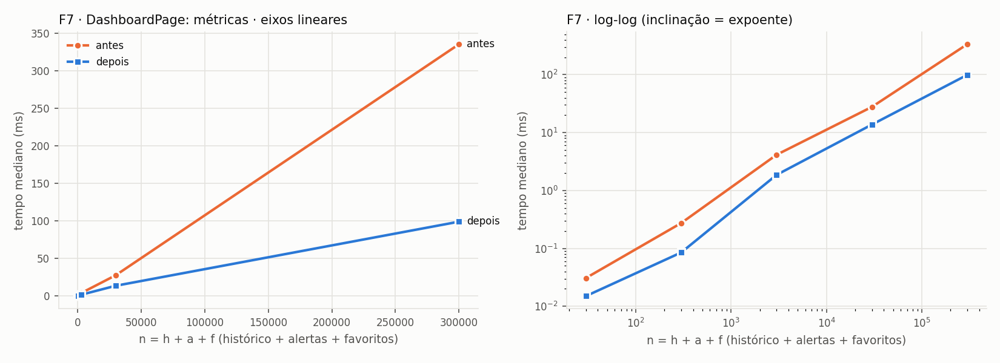

**Formato observado versus previsto.**
- As duas versões são lineares, ambas com R² ≥ 0,999 no ajuste a + b·n. O coeficiente cai de b ≈ 1,12 µs para b ≈ 0,33 µs por elemento (3,4×). As curvas são retas paralelas no log-log: mesma classe, fator constante. É o formato esperado de uma melhora só de constante.
- O fator ponto a ponto varia entre 2,0× e 3,4× (tabela). Abaixo de 1 ms a medição é sensível ao JIT e ao coletor de lixo; nesta rodada isso também deixa a inclinação entre os dois maiores n em 1,08 antes e 0,86 depois. O ajuste é a leitura mais estável.
- **Speedup acima da contagem de operações.** A contagem previa algo perto de 16h : 11h ≈ 1,4, mas as operações não custam o mesmo. O dominante é parsear `new Date(string)`: antes eram 2h + 2a⁺ + 2f parsings (cada janela refazia o parse) e depois h + a⁺ + f, exatamente a metade. Somam-se as alocações dos arrays intermediários (`filter` e `map`), que a versão nova não faz.

### F8 — `buildHistorySeries`

**Responsável:** Vithor dos Santos
**Arquivos:** `frontend/src/lib/historySeries.ts` (extraído de `frontend/src/pages/ProductDetailPage.tsx`)

**Antes**

```ts
const sorted = history
  .slice()
  .sort((left, right) => new Date(left.capturedAt).getTime() - new Date(right.capturedAt).getTime());
for (const entry of sorted) { ... }
```

**Depois**

```ts
function ascendingOrder(timestamps: number[]): number[] {
  if (isNonIncreasing(timestamps)) {
    return reverseKeepingTies(timestamps);
  }
  return timestamps.map((_, index) => index).sort((left, right) => timestamps[left] - timestamps[right]);
}

const timestamps = history.map((entry) => new Date(entry.capturedAt).getTime());
for (const index of ascendingOrder(timestamps)) { ... }
```

`reverseKeepingTies` percorre o array de trás para frente agrupando timestamps iguais, e emite cada grupo **na ordem original**. É o que o `sort` estável faz com os empates.

**Definição de n.** h é o número de entradas do histórico. Em produção h ≤ 30, porque `listProductPriceHistory` usa `take: 30`, e a API devolve em ordem decrescente de `capturedAt`.

**Contagem de operações — antes.** Seja C(h) o número de comparações do `Array.prototype.sort` (TimSort no V8). Cada comparação cria 2 `Date`.

| Linha | Custo | Execuções |
|---|---|---|
| `slice` | c₁ | h |
| comparador (2 `new Date` + subtração) | c₂ | C(h) |
| laço de montagem (1 `new Date`, até 2 `toISOString`) | c₃ | h |

T_antes(h) = (c₁ + c₃)h + c₂·C(h).

- **Pior caso** (entrada aleatória): C(h) = Θ(h log h).
- **Melhor caso** (entrada já crescente, ou **estritamente** decrescente): C(h) = h − 1, porque o TimSort detecta a sequência e a inverte em Θ(h).

Logo O(h log h) e Ω(h). **Θ não se aplica**, porque os dois casos diferem.

**Contagem de operações — depois.**

| Linha | Custo | Execuções |
|---|---|---|
| `map` de timestamps (1 `new Date` por entrada) | c₄ | h |
| `isNonIncreasing` (para na 1ª violação) | c₅ | ≤ h − 1 |
| `reverseKeepingTies` (cada índice visitado 2 vezes) | c₆ | 2h |
| fallback: `sort` de índices com comparador barato (subtração) | c₇ | C(h), só se a entrada não for não crescente |
| laço de montagem (sem `new Date` para o timestamp) | c₃′ | h |

- **Melhor caso:** entrada não crescente, **inclusive com empates**, que é a ordem do contrato da API. T_depois = (c₄ + c₅ + 2c₆ + c₃′)h = Θ(h).
- **Pior caso:** entrada desordenada. T_depois = Θ(h) + c₇·C(h) = Θ(h log h).

O(h log h) e Ω(h). Θ não se aplica à função inteira, mas na entrada do contrato o custo é Θ(h).

**O, Ω e Θ.**
- **Pior caso:** não muda de classe, O(h log h) nas duas versões.
- **Melhor caso:** Ω(h) nas duas, mas cobre entradas diferentes. O original atinge Θ(h) quando a entrada é crescente ou **estritamente** decrescente. A versão nova atinge Θ(h) em qualquer entrada não crescente, **inclusive com empates**, que é o contrato da API.
- **Na prática:** como h ≤ 30 em produção, o ganho é assintótico mas irrelevante para o sistema (achado A7). F8 **não** é usada para cumprir a meta B.

**Espaço.**
- Antes: Θ(h), com a cópia do `slice`, o buffer do TimSort e os pontos.
- Depois: Θ(h), com timestamps, ordem de índices e pontos.
- Mesma classe.

**Corretude e equivalência.**
- A versão nova produz a mesma permutação que o `sort` estável. Na entrada não crescente, a inversão por grupos preserva a ordem original entre empates. No fallback, o comparador devolve **os mesmos valores** do original (diferença de timestamps) para os mesmos pares, então o mesmo algoritmo gera a mesma permutação.
- Data inválida gera o mesmo `RangeError` no `toISOString`.

Teste: `frontend/tests/unit/lib/historySeries.equivalence.test.ts`, com 7 combinações de ordem e taxa de empate × 7 tamanhos × 10 sementes, empates explícitos, histórico vazio com relógio congelado, imutabilidade da entrada e data inválida.

**Medição.** Três cenários: decrescente (contrato), decrescente com 30% de empates e aleatório.

**Cenário `aleatorio`**

| n | antes (ms) | depois (ms) | antes ÷ depois |
|---|---|---|---|
| 10 | 0,03 | 0,02 | 1,9× |
| 100 | 0,45 | 0,16 | 2,9× |
| 1.000 | 6,64 | 1,62 | 4,1× |
| 10.000 | 99,0 | 18,4 | 5,4× |
| 100.000 | 2.008 | 518 | 3,9× |

Inclinação no log-log entre os dois maiores n medidos (tempo): antes: 1,31; depois: 1,45.

Ajuste linear t(n) = a + b·n por mínimos quadrados sobre todos os pontos:

- antes: a = -27,95 ms, b = 20,2837 µs por unidade de n, R² = 0,998
- depois: a = -8,91 ms, b = 5,2450 µs por unidade de n, R² = 0,996

**Cenário `decrescente`**

| n | antes (ms) | depois (ms) | antes ÷ depois |
|---|---|---|---|
| 10 | 0,02 | 0,02 | 1,1× |
| 100 | 0,20 | 0,14 | 1,4× |
| 1.000 | 2,41 | 1,34 | 1,8× |
| 10.000 | 23,3 | 24,5 | 0,9× |
| 100.000 | 289 | 186 | 1,6× |

Inclinação no log-log entre os dois maiores n medidos (tempo): antes: 1,10; depois: 0,88.

Ajuste linear t(n) = a + b·n por mínimos quadrados sobre todos os pontos:

- antes: a = -1,49 ms, b = 2,9057 µs por unidade de n, R² = 1,000
- depois: a = 1,24 ms, b = 1,8564 µs por unidade de n, R² = 0,999

**Cenário `decrescente_com_empates`**

| n | antes (ms) | depois (ms) | antes ÷ depois |
|---|---|---|---|
| 10 | 0,02 | 0,02 | 0,9× |
| 100 | 0,45 | 0,18 | 2,5× |
| 1.000 | 4,74 | 1,43 | 3,3× |
| 10.000 | 45,0 | 14,2 | 3,2× |
| 100.000 | 549 | 189 | 2,9× |

Inclinação no log-log entre os dois maiores n medidos (tempo): antes: 1,09; depois: 1,12.

Ajuste linear t(n) = a + b·n por mínimos quadrados sobre todos os pontos:

- antes: a = -2,59 ms, b = 5,5130 µs por unidade de n, R² = 1,000
- depois: a = -1,23 ms, b = 1,8984 µs por unidade de n, R² = 0,999

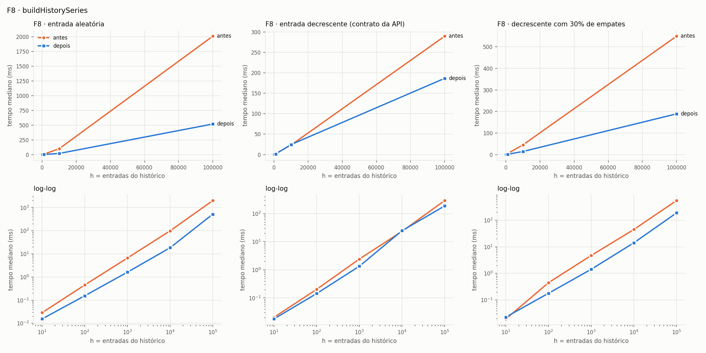

**Formato observado versus previsto.**
- **Aleatória:** as duas versões ordenam. A nova só tem comparador mais barato (subtração de números já calculados, em vez de 2 `new Date` por comparação), e por isso fica 1,9–5,4× mais rápida sem mudar de classe. A teoria prevê h log h nas duas.
- **Estritamente decrescente:** as curvas quase coincidem (fator 0,9–1,8×). O TimSort detecta a sequência estritamente decrescente e a inverte em Θ(h), como previsto.
- **Decrescente com empates:** fator de 2,5–3,3× para h ≥ 100, praticamente constante. **Divergência com a teoria**, que prevê h log h para "antes" e h para "depois":
  - Com empates, o TimSort quebra a entrada em blocos curtos e os intercala. Como os blocos já estão em ordem decrescente entre si, o modo *galloping* resolve cada fronteira com O(log) comparações; o que sobra é cópia de memória, barata.
  - Entre 10⁴ e 10⁵ o fator log h cresce só 25%, o que é indistinguível do ruído nesta faixa.
  - Todas as versões e cenários têm R² ≥ 0,996 no ajuste **linear** a + b·h.
  - As inclinações entre dois pontos variam de uma rodada para outra. Nesta rodada foram 1,09 antes e 1,12 depois com empates, e 1,31 e 1,45 na entrada aleatória. Em rodada anterior, "antes" com empates deu 1,02 e 1,10. Mostram efeito de cache e de coletor de lixo com 100 mil objetos, não de classe.
- **Custo de montagem:** os dois `toISOString` por entrada (iguais nas duas versões) pesam muito no total. Isso aproxima as inclinações de 1 e esconde o termo log h.

---

## 3. Tabela comparativa

| Função | Arquivo | O antes | O depois | Estratégia adotada |
|---|---|---|---|---|
| F1 `searchProducts` → upsert dos produtos | `backend/src/services/productService.ts`, `productBatchUpsert.ts` | Θ(n) idas ao banco | Θ(1) idas (≤ 6 comandos) | lote: 1 leitura com `= ANY($1)`, 1 INSERT, 1 UPDATE e 1 INSERT de histórico via `jsonb_to_recordset`, numa transação |
| F2 `searchProducts` → produtos excluídos | `backend/src/services/productService.ts` | Θ(D + n) tempo, Θ(D) espaço | O(n log N) tempo, Θ(n) espaço | coluna `normalizedProductUrl` preenchida na escrita, índice `(isDeleted, normalizedProductUrl)`, consulta só das URLs da página |
| F3 `createProduct` | `backend/src/services/productService.ts` | Θ(S) | O(log S) no caminho de sucesso; Θ(S) no pior caso (erro de dono) | índice funcional parcial `lower(name) WHERE isActive`; `EXISTS`/`LIMIT 1` por igualdade; ILIKE só como fallback |
| F4 `loadProduct` (favorito) | `frontend/src/pages/ProductDetailPage.tsx`, `favoriteService.ts` | Θ(F) tempo e bytes | O(log F) tempo, Θ(1) bytes | endpoint `GET /favorites/product/:productId` com o índice único `(userId, productId)` |
| F5 `loadSearchResults`/`loadShowcase` | `frontend/src/pages/HomePage.tsx`, `favoriteService.ts` | Θ(F + k) | O(k log F) tempo, Θ(k) bytes | endpoint `POST /favorites/lookup` com os ids da página |
| F6 `searchProducts` → produtos locais | `backend/src/services/productService.ts` | Θ(L) linhas na aplicação | Θ(k + n) linhas na aplicação (banco segue Θ(N)) | `take: limit` + `count` + contagem de sobreposição só quando necessária |
| F7 métricas do Dashboard | `frontend/src/lib/dashboardMetrics.ts` | Θ(h + a + f), 13 passadas | Θ(h + a + f), 1 passada por coleção | pré-computação em uma passada (só constante) |
| F8 `buildHistorySeries` | `frontend/src/lib/historySeries.ts` | O(h log h), Ω(h) | O(h log h), Ω(h); Θ(h) na entrada do contrato | detecção de ordem não crescente e inversão por grupos estáveis; `sort` como fallback |

---

## 4. Verificação das metas

**A — as 8 funções analisadas formalmente antes e depois.** Cumprida. A seção 2 tem, para F1–F8:
- definição de n;
- tabela de custo por linha × número de execuções, com a soma de T(n);
- O, Ω e Θ, com melhor e pior caso separados quando diferem (F2, F3, F5 e F8);
- espaço antes e depois;
- argumento de corretude;
- gráfico.

**B — ao menos 3 funções mudam de classe de verdade.** Cumprida com 5:

| Função | Grandeza | Antes | Depois | Evidência medida |
|---|---|---|---|---|
| F1 | idas ao banco | Θ(n) | Θ(1) | consultas: 12 → 6 (n = 10) e 11.581 → 6 (n = 10.000); 6 com n = 100.000 |
| F2 | tempo em D | Θ(D) | O(log N) para página fixa | 63,1 → 3,0 ms (D = 10⁴) e 596 → 5,4 ms (D = 10⁵); b ≈ 0,02 µs por linha depois, contra 5,9 µs antes |
| F3 | tempo em S (caminho de sucesso) | Θ(S) | O(log S) | 58,4 → 12,1 ms (S = 10⁴) e 294 → 10,5 ms (S = 10⁵); b ≈ 0 depois; EXPLAIN com `Index Scan` |
| F4 | tempo e bytes em F | Θ(F) | O(log F), Θ(1) bytes | 4.726 → 3,1 ms e 62,0 MB → 96 B com F = 10⁵ |
| F5 | tempo e bytes em F | Θ(F + k) | O(k log F), Θ(k) bytes | 4.475 → 4,5 ms e 62,0 MB → 389 B com F = 10⁵ |

F6, F7 e F8 **não** são contadas: F6 continua Θ(N) no banco, F7 é só constante e F8 muda apenas no melhor caso (e h ≤ 30).

**C — nenhuma função piora de classe, em tempo ou em espaço.** Cumprida.

| Função | Tempo antes → depois | Espaço auxiliar antes → depois | Armazenamento persistente novo |
|---|---|---|---|
| F1 | Θ(n) → Θ(n) em trabalho; Θ(n) → Θ(1) em idas | Θ(n) → Θ(n) | — |
| F2 | Θ(D + n) → O(n log N) | Θ(D) → Θ(n) | coluna e índice: Θ(N) |
| F3 | Θ(S) → O(log S) no sucesso, O(S) no pior | Θ(S) → Θ(1) | índice parcial: Θ(S_a) |
| F4 | Θ(F) → O(log F) | Θ(F) → Θ(1) | — |
| F5 | Θ(F + k) → O(k log F) | Θ(F) → Θ(k) | — |
| F6 | aplicação Θ(L) → Θ(k + n); banco Θ(N) → Θ(N) | Θ(L) → Θ(k + n) | — |
| F7 | Θ(h + a + f) → Θ(h + a + f) | Θ(h + a + f) → Θ(h) | — |
| F8 | O(h log h) → O(h log h); Ω(h) → Ω(h) | Θ(h) → Θ(h) | — |

Os índices e a coluna são armazenamento do schema, pago uma vez. Não são espaço auxiliar das funções. As escritas que mantêm a coluna (`createProduct`, `updateProduct`, `upsertProduct`, lote da F1) ganham O(|url|) por linha, o que não muda a classe de nenhuma delas.

**D — saída idêntica para toda entrada válida.** Cumprida, com o domínio de entrada válida declarado. Cada função tem um teste de equivalência que roda a versão original (`backend/bench/legacy/`, `frontend/bench/legacy/`) e a nova sobre as mesmas entradas, geradas com semente fixa, e compara com `toEqual`:

| Função | Teste | O que compara |
|---|---|---|
| F1 | `backend/tests/equivalence/upsertProductsBatch.test.ts`, `searchProducts.test.ts` | estado final do banco, ordem de criação e de histórico, resultado da busca |
| F2 | `backend/tests/equivalence/searchProducts.test.ts`, `backfillNormalizedProductUrl.test.ts` | resultado e estado do banco; backfill |
| F3 | `backend/tests/equivalence/createProduct.test.ts` | produto criado ou mensagem de erro, e estado do banco |
| F4, F5 | `frontend/tests/unit/pages/favoritesLookup.equivalence.test.tsx` | cards renderizados (favorito e id), mensagens e chamada de remoção |
| F6 | `backend/tests/equivalence/searchProducts.test.ts` | resultado completo da busca (produtos, totais e paginação) |
| F7 | `frontend/tests/unit/lib/dashboardMetrics.equivalence.test.ts` | todas as métricas, com `Object.is` nas somas |
| F8 | `frontend/tests/unit/lib/historySeries.equivalence.test.ts` | pontos da série, empates e erro |

O domínio de entrada válida declarado:
- preço finito, 0 ≤ preço < 10⁸ e, para duplicados na mesma resposta da SerpApi, até 2 casas decimais (A13, A14);
- nomes de loja sem `İ` nem sigma final grego (A3);
- referência sequencial para duplicados de `externalId` (A12).

Totais: 56 testes de equivalência em banco real no back (`npm run test:equivalence`) e 28 no front (incluídos em `npm run test`), todos verdes.

**E — o ganho aparece no gráfico tempo × n.** Cumprida. Cada função tem um PNG com as duas curvas sobrepostas, em escala linear e log-log, em `docs/complexidade/graficos/`. F1 e F2–F6 também têm consultas × n, e F4/F5 têm bytes × n. Nas funções que mudam de classe, a curva "depois" é horizontal (b ≈ 0 no ajuste linear) enquanto a "antes" é uma reta com R² ≥ 0,99. Na F1, a mudança aparece no gráfico de consultas; o tempo segue linear nas duas versões, com coeficientes diferentes.

---

## 5. Achados

Os achados abaixo foram **registrados, mas não corrigidos** (exceto onde indicado), para manter a saída idêntica.

**A1. Assimetria na tratativa de erro de favoritos na HomePage (F5): provável bug.**
- Em `loadSearchResults`, a falha ao buscar favoritos tem `try` próprio e a busca segue com o `Map` vazio.
- Em `loadShowcase` não há `try` próprio: qualquer falha em favoritos derruba a vitrine com "Não foi possível carregar os resultados agora. Tente novamente.".
- Como `GET /favorites` responde 401 para visitantes sem login, **a vitrine nunca carrega para quem não está logado**. O comportamento foi preservado: o front chama o endpoint novo mesmo com 0 ids, justamente para manter esse 401.

**A2. Resultados externos nunca aparecem como favoritos (F5).** Na busca, os produtos vindos da SerpApi têm `id = externalId`, enquanto o favorito guarda o `id` (UUID) do produto no banco. A comparação `favoritesByProduct.has(product.id)` nunca casa para esses produtos. O `IN` por ids da página preserva exatamente isso.

**A3. `lower()` do Postgres versus `toLowerCase()` do JS (F3).**
- Comparamos os dois em 1.215 code points (U+0020–U+04FF, sem controles) no Postgres 16 do `docker-compose` (`datcollate`/`datctype` = `en_US.utf8`, provedor libc).
- Só divergem `İ` (U+0130): `"i̇"` no JS e `"i"` no Postgres. Também diverge o sigma final contextual: `"ΣΑΣ".toLowerCase()` dá `"σας"` e o `lower()` dá `"σασ"`.
- Todos os acentos usados em pt-BR coincidem.
- Nomes de loja com esses caracteres podem ter resultado diferente na etapa 3. Esse é o limite do domínio de entrada válida declarado para a F3.
- **Não verificado em produção:** o banco do produto fica no Neon, e o locale/provedor de collation de lá não foi checado (ver A18). Se for diferente de `en_US.utf8`/libc, a comparação precisa ser refeita no próprio Neon antes de considerar a F3 equivalente em produção.

**A4. `mode: "insensitive"` do Prisma gera `ILIKE` sem escapar a entrada.**
- Em `updateProduct`, um `storeName` igual a `"%"` passa a validação se o usuário tiver qualquer loja ativa.
- Em `createProduct`, `"Loja_1"` passa a etapa 4 se a etapa 3 casou com a loja `Loja_1` de outro usuário e o usuário atual tem `LojaX1`.
- O comportamento foi preservado: a F3 cai no `ILIKE` original sempre que a igualdade exata falha. Os dois casos estão em `tests/equivalence/createProduct.test.ts`.

**A5. A busca local (F6) continua Θ(N) no banco.** `ILIKE '%termo%'` não usa índice B-tree, então `findMany` e `count` varrem a tabela. Isso também contamina a busca completa da F2 (gráfico F2b). Trabalho futuro: `CREATE EXTENSION pg_trgm` e um índice GIN `gin_trgm_ops` em `name` e `category`.

**A6. Na F1 em produção, n ≤ 24.** O controller limita `limit` a 24, e `searchSerpApi` corta a resposta em `limit` itens. O ganho real é trocar até 72 idas ao banco por no máximo 6. O tempo total continua Θ(n) nas duas versões, mas o termo dominante passa de c_rt·n para 6c_rt.

**A7. Na F8, h ≤ 30.** `listProductPriceHistory` usa `take: 30`, então o ganho assintótico não tem efeito prático. Além disso, o TimSort já é Θ(h) para entrada estritamente decrescente; a diferença de classe só aparece com empates ou com entrada desordenada.

**A8. `include` com `take: 1` carrega o histórico inteiro.** No Prisma 5.22, `priceHistory: { orderBy, take: 1 }` dentro de `findMany` vira uma consulta `WHERE productId IN (...) ORDER BY id` **sem** limite por produto. O corte é feito em memória. Isso afeta `searchProducts`, `getShowcaseProducts` e `getProductById`: o custo cresce com o histórico total dos produtos da página. Verificamos isso pelos eventos de query.

**A9. O Prisma agrupa `findUnique` concorrentes (dataloader).** É por isso que o laço original da F1 faz ≈ 1,16 consulta por produto, e não 2 a 3 (ver CSV da F1). A classe não muda.

**A10. O Prisma fatia `IN` grandes em lotes de 32.766 parâmetros.** Com F = 100.000, o `GET /favorites` original faz 5 consultas (CSV da F4/F5).

**A11. O motor do Prisma entra em pânico no `searchProducts` original com 100 mil produtos locais.** Mensagem: `thread 'tokio-runtime-worker' panicked at query-engine\query-structure\src\record.rs:69:46: no entry found for key`, na `findMany` com `include` do histórico. A versão nova (`take: limit`) não carrega esse volume.

**A12. Duplicados de `externalId` no `Promise.allSettled` original geram corrida.**
- Duas ocorrências do mesmo produto rodam `findUnique` ao mesmo tempo. A segunda pode ver o produto como inexistente (sem histórico) ou existente (com histórico), e o último a escrever vence de forma não determinística.
- O mesmo vale para a ordem de `createdAt` entre produtos criados na mesma busca.
- Adotamos a semântica sequencial (ver F1). O teste de busca completa evita esses cenários de corrida; o teste da F1 compara contra a referência sequencial.

**A13. Preço com mais de 2 casas decimais gera histórico a cada busca.**
- O banco guarda `Decimal(10,2)` arredondado, e o original compara `Number(existing.price)` com o preço JS sem arredondar. Um preço `19.999` vira `20.00` e gera um registro de histórico `20 → 19.999` toda vez que aparece.
- O lote preserva isso para itens distintos. Para duplicados na mesma lista, a simulação usa o preço JS da ocorrência anterior, o que exige preços com até 2 casas decimais (domínio declarado; `extracted_price` da SerpApi segue esse formato).

**A14. Falha em lote é tudo ou nada.** O `allSettled` isolava falhas por produto, por exemplo um preço que estoura `Decimal(10,2)`. O lote roda em uma transação, então uma linha inválida descarta todas as escritas da busca. A busca continua respondendo, porque a falha é engolida como antes. Domínio declarado: preço finito com 0 ≤ preço < 10⁸.

**A15. O Prisma não serializa arrays com `NULL` no `unnest`.** Arrays de texto com elementos `null` passados como parâmetro geraram `ERROR: improper binary format in array element` (Postgres `22P03`). A solução foi enviar as linhas como **um único parâmetro JSON** e expandi-las com `jsonb_to_recordset`. Isso mantém um comando por etapa, sem o limite de parâmetros do Postgres e sem interpolar strings.

**A16. Falhas pré-existentes encontradas na linha de base.**
- **Corrigido** em commit próprio: o build do front já falhava com 4 erros de tipo em `FavoritesPage.tsx` e `ui/button.tsx`.
- **Não corrigido:** os testes do front têm 48 erros de tipo e os do back têm 13 (nenhum CI verifica). Por isso o script `typecheck` cobre `src`, `scripts` e `bench`.
- **Não corrigido:** o Prettier do back já reprovava 41 arquivos (não há CI de formatação para o back). Só os arquivos tocados foram formatados.
- O lint do back tem 0 erros. Os avisos foram de 114 para 117 (todos `no-explicit-any`): +2 nos dois controllers novos de favoritos, que seguem o padrão `(request as any).user` dos controllers existentes; +2 na cópia fiel do original em `bench/legacy`; −1 pelo `as any` removido do `createProduct`. O lint do front segue com 1 aviso pré-existente (`exhaustive-deps` em `AlertsPage.tsx`).

**A17. A coluna normalizada exige backfill.** Bancos que já existem precisam rodar `npm run db:backfill-normalized-url` uma vez após a migration. Sem isso, produtos excluídos antes da migration não seriam filtrados. O teste `tests/equivalence/backfillNormalizedProductUrl.test.ts` cobre o script.

**A18. O banco de produção fica no Neon; todas as medições foram feitas no Postgres local.**
- Testes de equivalência e medições rodaram no Postgres 16 do `docker-compose`, em bancos separados (`pricewatch_test`, `pricewatch_bench`). Nada foi executado no Neon.
- **Latência:** no Neon, cada ida ao banco atravessa a rede até um Postgres gerenciado, com custo bem maior que o c_rt local (< 1 ms). Em F1, F4 e F5 o ganho está em idas e em bytes, então em produção a diferença tende a ser **maior** que a medida. As contagens de consultas e de bytes valem igual nos dois ambientes; os tempos absolutos, não.
- **Locale:** a equivalência de `lower()` com `toLowerCase()` (F3, A3) foi verificada só no locale local; o do Neon não foi checado.
- **Deploy:** no Neon é preciso aplicar as duas migrations (`prisma migrate deploy`) e, em seguida, rodar `npm run db:backfill-normalized-url` uma vez (A17).

---

## 6. Como reproduzir

Pré-requisitos: Docker Desktop, Node 22 e Python 3 com matplotlib.

Uma vez:

```bash
docker compose up -d postgres
```

```bash
cd backend && npm ci && cp .env.example .env && cd ../frontend && npm ci
```

Depois, um único comando na raiz do repositório reproduz tudo:

```bash
npm run bench
```

Esse comando (`scripts/bench-all.mjs`):
1. cria `pricewatch_test` e `pricewatch_bench` se não existirem e aplica as migrations nos dois, derivando a URL do `DATABASE_URL` de `backend/.env`;
2. roda os testes de equivalência em banco real (`npm run test:equivalence`);
3. roda as medições do back (F1–F6, F2b e o `EXPLAIN` da F3) e do front (F7, F8);
4. gera os gráficos (`bench/plot.py`) e imprime as tabelas deste relatório (`bench/tables.py`).

Para rodar só algumas medições do back: `cd backend && npm run bench -- f1 f3`.

Outros comandos:
- verificação de comentários: `npm run check:comments` na raiz;
- backfill da coluna nova em bancos existentes: `cd backend && npm run db:backfill-normalized-url`.
